<div align="center">

# M+X · Firmware abierto para láser, CNC y plotter de pluma

**Grbl_ESP32 con interfaz web propia y pantalla táctil rediseñada, en español, inglés, portugués y chino**

<sub>Basado en el firmware de las placas MKS DLC32 de Makerbase</sub>

[](LICENSE)
[](https://github.com/bdring/Grbl_Esp32)
[](https://lvgl.io)
[](https://platformio.org)
[](#-idiomas)

<br>

[](#-hardware-probado)

<br>

<table>
<tr>
<td align="center">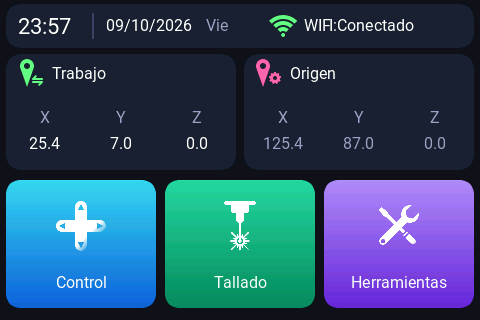<br><sub><b>Pantalla táctil</b> (480×320)</sub></td>
<td align="center">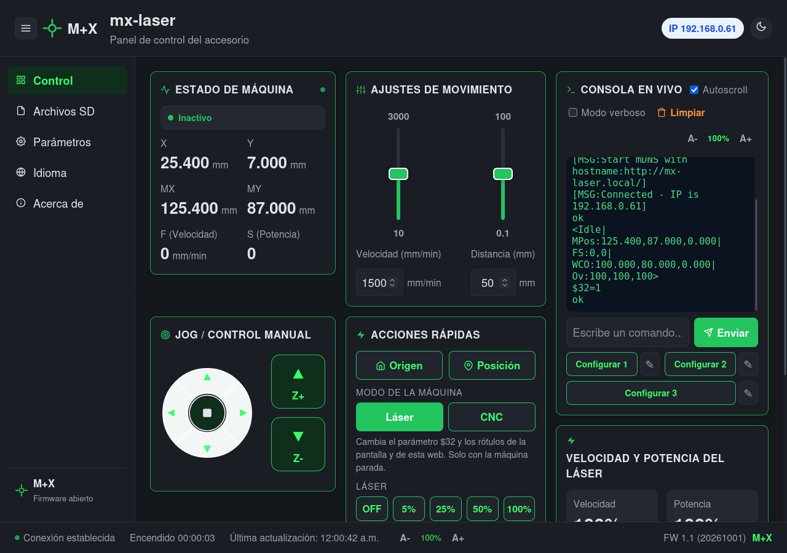<br><sub><b>WebUI</b> en el navegador</sub></td>
</tr>
</table>

</div>

---

## Contenido

[Hardware probado](#-hardware-probado) · [Qué incluye](#-qué-incluye) · [Pantalla LCD](#-pantalla-táctil-lcd) · [WebUI](#-webui) · [Modo láser y seguridad](#-modo-láser-y-seguridad) · [Sonidos](#-sonidos) · [Idiomas](#-idiomas) · [Ajustes `$`](#-ajustes--clave) · [Variante PLOTTER](#-variante-plotter-dibujo-con-pluma) · [Compilar y flashear](#-compilar-y-flashear) · [Actualizar la WebUI](#-actualizar-la-webui-sin-cable) · [Imagen de inicio](#-imagen-de-inicio) · [Simulador](#-simulador-del-lcd-y-capturas) · [Estructura](#-estructura-del-repositorio) · [Problemas frecuentes](#-problemas-frecuentes) · [Qué cambió](#-qué-cambió-respecto-al-firmware-de-mks) · [Créditos](#-créditos-y-licencia)

---

## 🧪 Hardware probado

| Dato | Detalle |
|---|---|
| **Placa** | **MKS LTS V1.1** (así está serigrafiada) |
| **Máquina** | **TTS 55 PRO de 5 W** (láser de diodo) |
| **Chip** | ESP32-D0WD, flash de **8 MB** |

> [!IMPORTANT]
> **Este firmware se desarrolla y prueba solo en esa combinación.** En otras placas o máquinas puede
> funcionar, pero no está verificado: revisa los pasos por mm (`$100`–`$102`), la velocidad y el recorrido
> (`$110`–`$132`) y el modo láser (`$32`) **antes de mover nada**.

| Placa | Estado |
|---|---|
| MKS LTS V1.1 (8 MB) | ✅ Probada: entorno `mks_dlc32_8mb` |
| **MKS DLC32 V2.1** | ✅ **Probada por el autor** con la variante PLOTTER (entorno `mks_dlc32_v2_1_plotter`, tabla de fábrica de 4 MB). El arranque y la WebUI también se verificaron con la tabla de 8 MB. También probada con la pluma en un **servo RC** (entorno `mks_dlc32_v2_1_plotter_servo`: servo, homing y pantalla probados en la máquina). |
| MKS DLC32 **V2.x** (otras revisiones) | ⚠️ **Sin probar.** Mismos entornos, pero no se han verificado en esas placas |
| *Programación por USB* | La V2.1 no entra en modo de descarga con la secuencia por defecto de algunas herramientas: su circuito de reset **cruza DTR y RTS** (ver [Variante PLOTTER](#-variante-plotter-dibujo-con-pluma)). Con la secuencia correcta, o llevando IO0 (`SDA` del conector «I²C interface») a GND al arrancar, sí entra |
| Otras (Sculpfun, AVR, STM32…) | ❌ No compatible: el firmware es específico de la MKS DLC32 |

## ✨ Qué incluye

<table>
<tr>
<td width="50%" valign="top">

### 🖐️ Pantalla táctil rediseñada
- Estilo oscuro con esmeralda, **480×320**, botones grandes
- **Español, inglés, portugués (Brasil) y chino** (con tildes, ñ y ç)
- Pantalla principal con **reloj por NTP** y coordenadas de trabajo/origen
- **Lista de la SD paginada** (`1/N`), circular, que abre el archivo al tocarlo
- **Marco** del trabajo con aviso para archivos grandes
- **Trabajo en curso** con tres diales: velocidad, potencia y rápido
- Herramientas: Wifi, idioma, **Beeper**, placa y acerca de
- Salta sola a la pantalla de trabajo si lo lanzas desde la web
- **Arranque** de 4 s con la versión en la esquina; **mantener pulsado** el logo muestra un **QR del repositorio** (tocarlo continúa)
- El reloj solo aparece cuando hay hora (por red); sin hora no se ve nada raro

</td>
<td width="50%" valign="top">

### 🌐 WebUI propia (un solo archivo de 45 KB)
- Control manual, estado en vivo y **consola**
- **Archivos SD** con vista previa del recorrido
- **Parámetros** con catálogo, copia de seguridad, exportar/importar
- Ajuste en vivo de **velocidad y potencia** (10 %–200 %)
- **Tema claro/oscuro**, panel lateral contraíble, tamaño de texto
- **Español, inglés, portugués y chino**
- **Vista previa** del grabado al elegir un archivo (en la pantalla y en la web), sin pulsar nada más; se guarda para no recalcularla
- **Carpetas** en la SD: contador de archivos y carpetas, navegar, crear, renombrar y eliminar
- **Pasadas**: al elegir un archivo se indica cuántas veces se repite (1 a 99)
- La lista de la SD llena la pantalla, hace scroll y deja siempre a la vista la **capacidad de la tarjeta**
- **Actualiza la propia WebUI** desde el navegador, sin cable

</td>
</tr>
<tr>
<td valign="top">

### 🔥 Láser de verdad
- `$32=1`: modo láser con **M4** funcional (`SpindleType::LASER`)
- Botón de láser con **potencias seguras 0 / 5 / 30 / 70 %**; nunca dispara al 100 % de golpe
- «Atrás» con el láser encendido **lo apaga**
- Rótulos de *Potencia y Velocidad* o *Husillo y Avance* según `$32`

</td>
<td valign="top">

### 🛠️ Correcciones de fondo
- **Sin tartamudeo ni reinicios:** la rampa del PWM ya no corre dentro de la interrupción
- Nombres de archivo **UTF-8** (`ñ`, acentos) en la SD
- Con un trabajo en marcha **no se desmonta la SD** al entrar en otra pantalla
- Sonidos de **fin de trabajo, error y alarma** (`$39`)

</td>
</tr>
</table>

---

## 🖐️ Pantalla táctil (LCD)

Todas las capturas las genera el [simulador](#-simulador-del-lcd-y-capturas) con **el mismo código que corre en la placa**
(datos de ejemplo). Están en [`docs/pantallas/`](docs/pantallas) en los tres idiomas.

<table>
<tr>
<td align="center"><br><sub><b>Principal</b><br>hora, coordenadas y tres accesos</sub></td>
<td align="center"><br><sub><b>Control</b><br>jog, ceros, sonda y láser</sub></td>
<td align="center">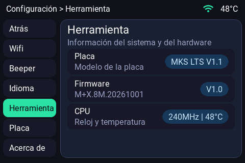<br><sub><b>Láser al 30 %</b><br>el popup se queda abierto</sub></td>
</tr>
<tr>
<td align="center">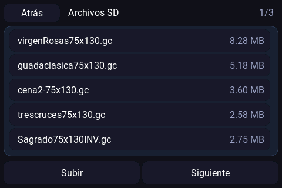<br><sub><b>Archivos SD</b><br>páginas circulares <code>1/3</code></sub></td>
<td align="center">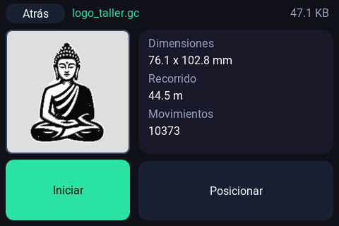<br><sub><b>Archivo elegido</b><br>vista previa del grabado, datos e Iniciar</sub></td>
<td align="center">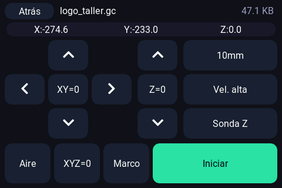<br><sub><b>Posicionar</b><br>mover, cero, marco e iniciar</sub></td>
<td align="center"><br><sub><b>Trabajo en curso</b><br>tres diales y progreso</sub></td>
</tr>
<tr>
<td align="center">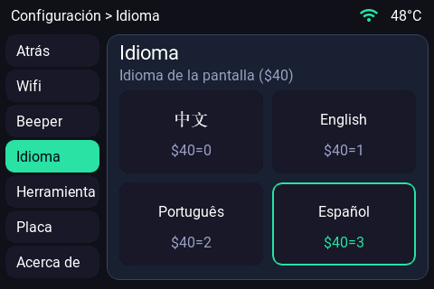<br><sub><b>Idioma</b><br>chino · inglés · portugués · español</sub></td>
<td align="center"><br><sub><b>Beeper</b><br>al tocar y alertas</sub></td>
<td align="center">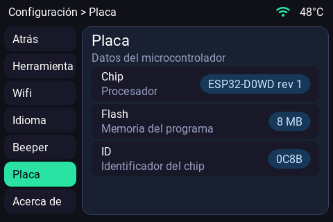<br><sub><b>Placa</b><br>chip, flash y versión</sub></td>
</tr>
</table>


<details>
<summary><b>Ver todas las pantallas en inglés, portugués y chino</b></summary>

<br>

**English**

<table>
<tr>
<td>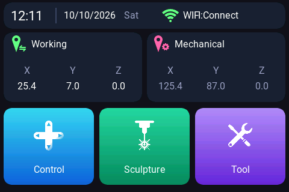</td>
<td>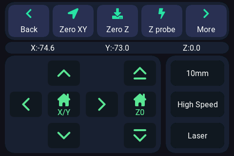</td>
<td>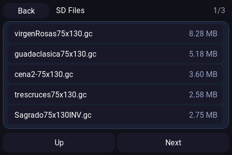</td>
</tr>
<tr>
<td>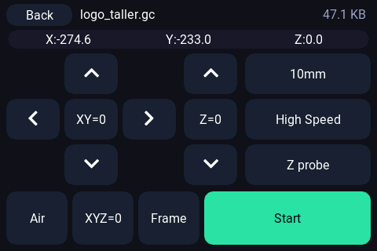</td>
<td>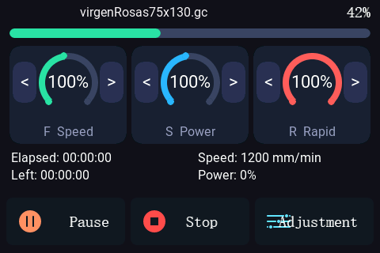</td>
<td>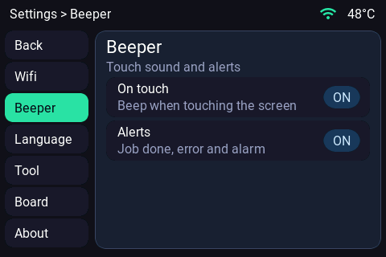</td>
</tr>
</table>

**Português**

<table>
<tr>
<td>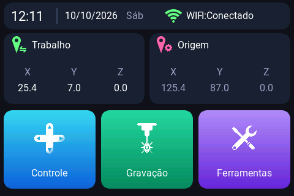</td>
<td>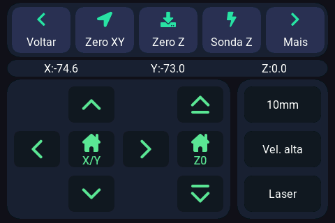</td>
<td>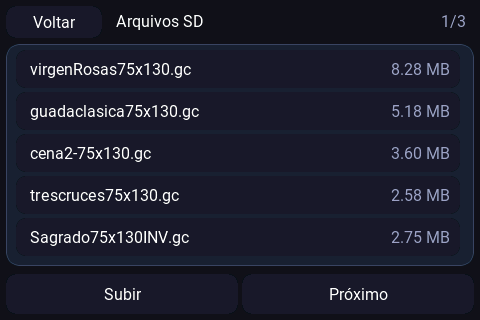</td>
</tr>
<tr>
<td>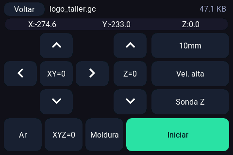</td>
<td>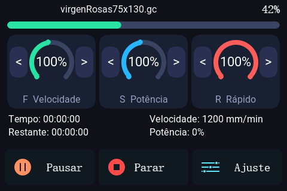</td>
<td>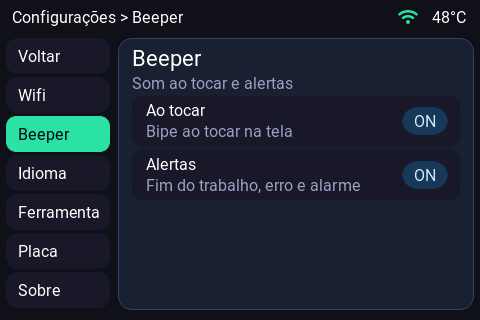</td>
</tr>
</table>

**中文**

<table>
<tr>
<td>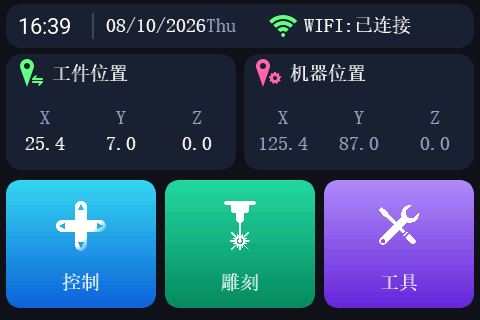</td>
<td>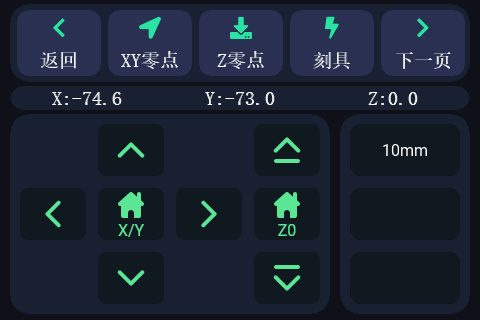</td>
<td>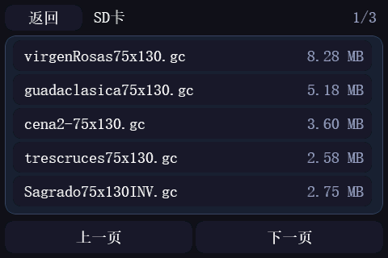</td>
</tr>
<tr>
<td>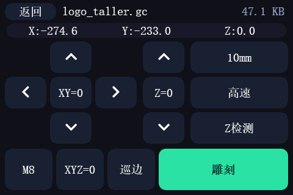</td>
<td>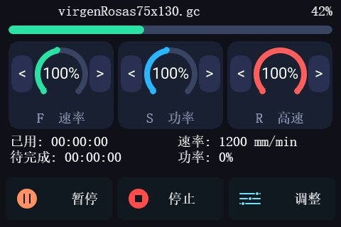</td>
<td>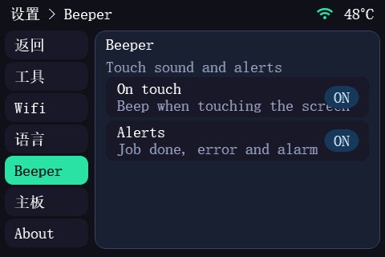</td>
</tr>
</table>

**Resto de pantallas (español)**

<table>
<tr>
<td>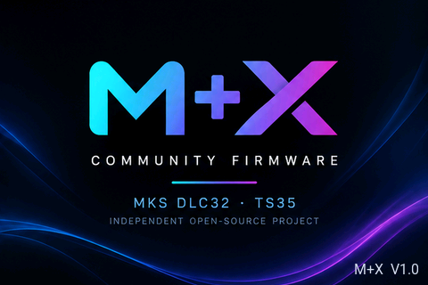<br><sub>Logo de inicio</sub></td>
<td>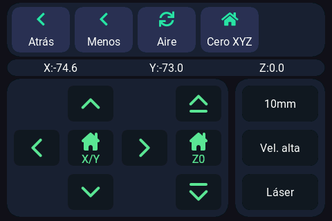<br><sub>Control, cabecera 2</sub></td>
<td><br><sub>Potencia del láser</sub></td>
</tr>
<tr>
<td>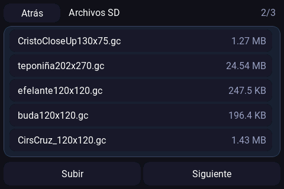<br><sub>SD, página 2</sub></td>
<td>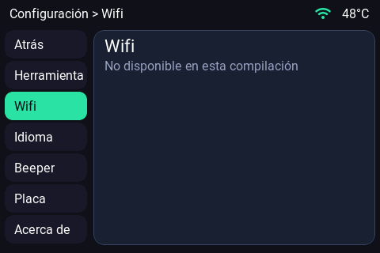<br><sub>Wifi</sub></td>
<td>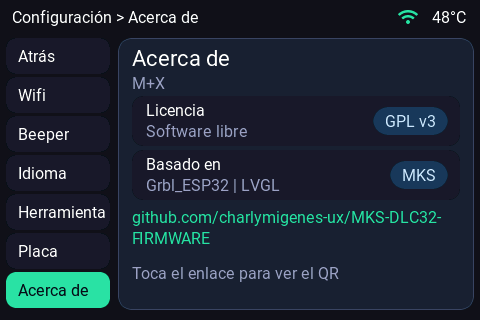<br><sub>Acerca de (el enlace abre el QR)</sub></td>
</tr>
<tr>
<td><br><sub>Arranque: mantener pulsado = QR</sub></td>
<td><br><sub>QR desde «Acerca de»</sub></td>
<td>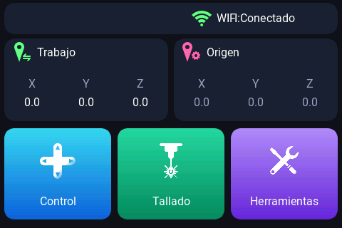<br><sub>Principal sin hora (sin reloj)</sub></td>
</tr>
</table>

</details>

### Cómo se usa

1. **Elegir y lanzar un archivo:** *Tallado* → toca el archivo (se abre solo) → coloca el cabezal con la cruceta → **Marco** (opcional) → **Iniciar**.
2. **Encender el láser a mano** (para enfocar): en *Control* pulsa **Láser** y elige 5 / 30 / 70 %. El popup queda abierto para cambiar la potencia o apagar con **0 %**; **Atrás** lo apaga y cierra.
3. **Páginas de la SD:** **Subir** y **Siguiente** son circulares: desde la página 1, *Subir* salta a la última.
4. **Arranque y QR:** el logo se ve 4 s. Si lo mantienes pulsado, al soltar aparece el QR del repositorio y el arranque espera; tocar el QR continúa. Lo mismo desde *Herramientas → Acerca de* pulsando el enlace.
5. **Ceros y sonda:** *Cero XY*, *Cero Z* y *Cero XYZ* fijan el origen de trabajo en la posición actual (⚠️ no mueven nada). *Sonda Z* usa el palpador de la placa.

---

## 🌐 WebUI

La interfaz web va **dentro del firmware** (un solo `index.html.gz` de unos 45 KB en la memoria interna), sin
internet ni dependencias externas. Entra a `http://<ip-de-la-placa>/`.

<table>
<tr>
<td align="center" width="50%"><br><sub><b>Control</b> · tema oscuro</sub></td>
<td align="center" width="50%">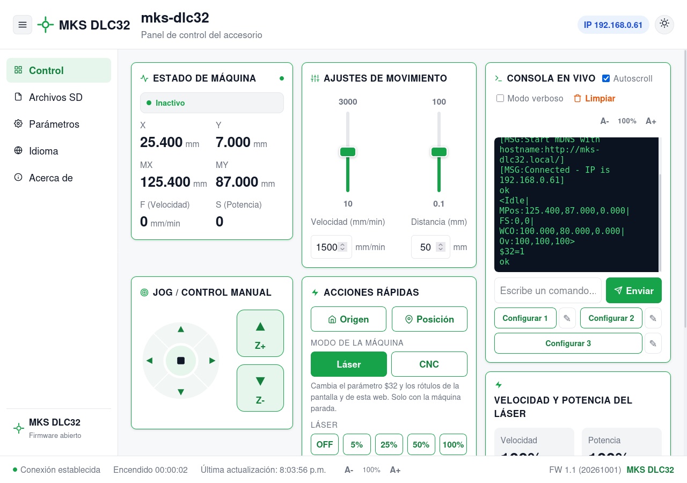<br><sub><b>Control</b> · tema claro</sub></td>
</tr>
<tr>
<td align="center">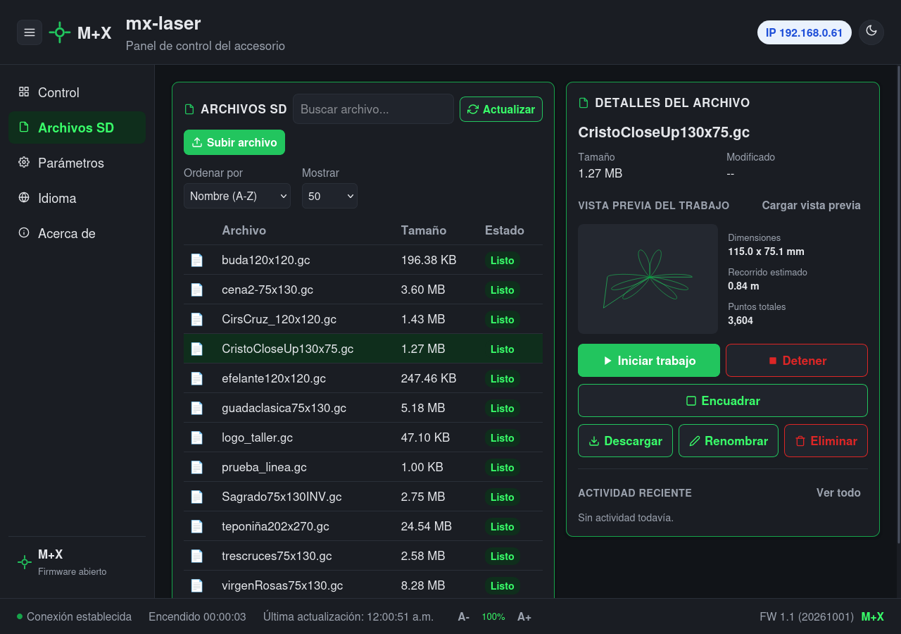<br><sub><b>Archivos SD</b> con vista previa del recorrido</sub></td>
<td align="center">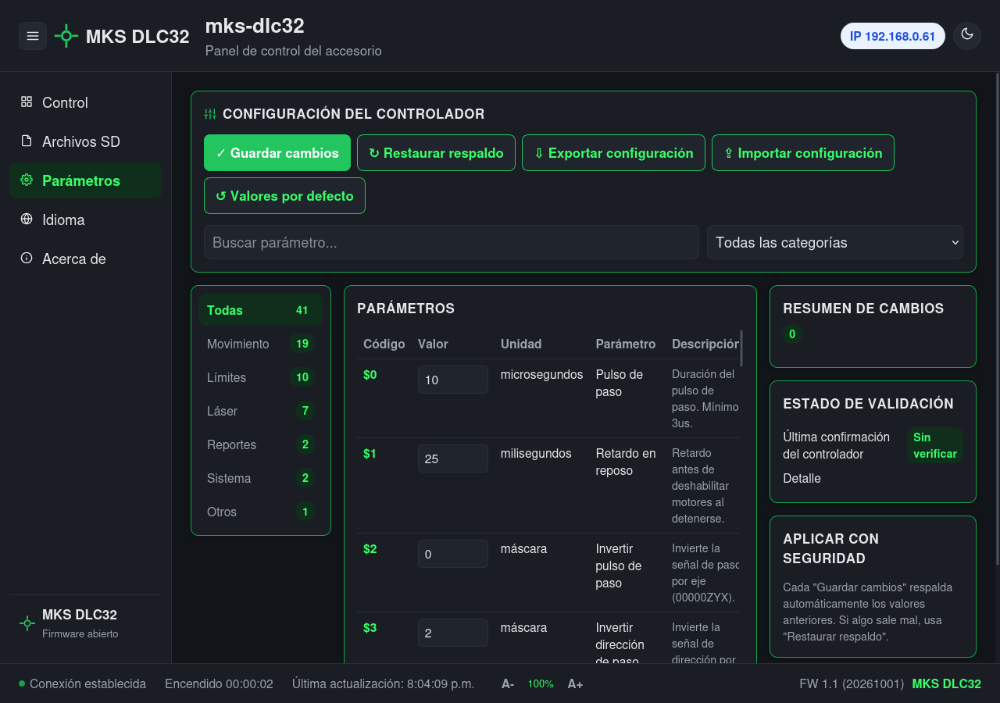<br><sub><b>Parámetros</b> con catálogo y respaldo</sub></td>
</tr>
<tr>
<td align="center">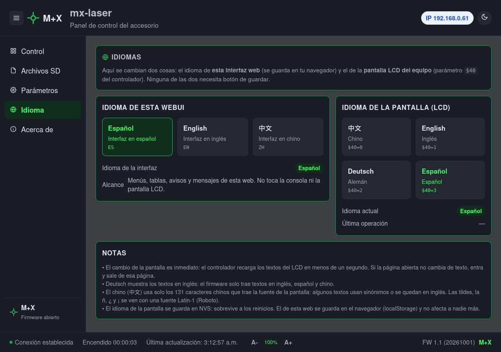<br><sub><b>Idioma</b> de la web y de la pantalla</sub></td>
<td align="center">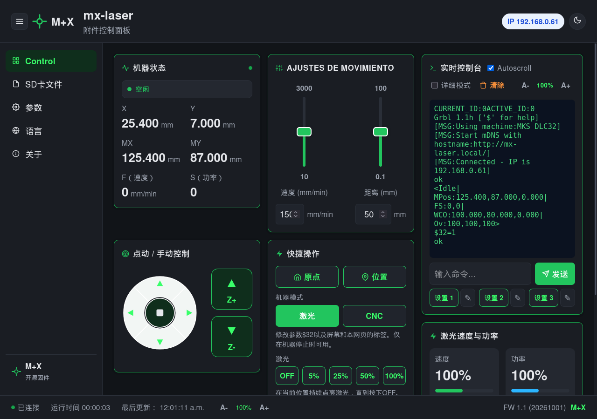<br><sub>La misma interfaz en <b>chino</b></sub></td>
</tr>
<tr>
<td align="center" colspan="2">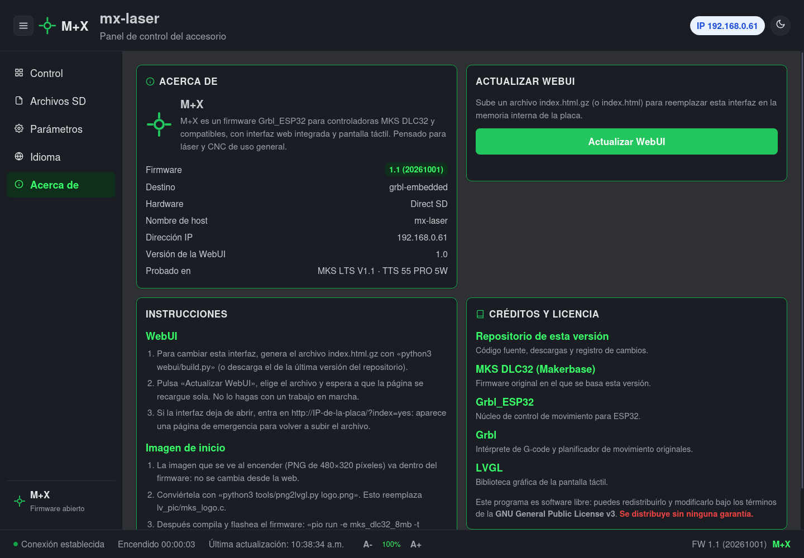<br><sub><b>Acerca de</b>: datos de la placa, actualizar la WebUI, instrucciones y créditos</sub></td>
</tr>
</table>

| Vista | Qué permite |
|---|---|
| **Control** | Estado en vivo (X/Y/Z, máquina y trabajo), jog con rueda y Z±, distancia y velocidad, **Origen**/**Posición**, modo **Láser/CNC** (`$32`), láser fijo con OFF/5/25/50/100 %, **consola** con filtro, modo verboso y tres macros configurables, **overrides** de velocidad y potencia de 10 % a 200 % |
| **Archivos SD** | Lista que ocupa toda la altura, con búsqueda y orden, subida múltiple con progreso, la capacidad de la SD siempre visible, **vista previa** (dimensiones, recorrido, puntos), **pasadas** (1–99), **Iniciar / Pausar / Detener**, **Encuadrar**, descargar, renombrar y eliminar, actividad reciente |
| **Parámetros** | Catálogo de `$` por categorías con descripción y unidad, búsqueda, **Guardar con respaldo automático**, restaurar, exportar/importar, valores por defecto (`$RST=$`) y resumen de cambios pendientes |
| **Idioma** | Idioma de la interfaz (se guarda en el navegador) e idioma de la pantalla LCD (`$40`) |
| **Acerca de** | Versión y datos de la placa, **Actualizar WebUI**, instrucciones y créditos |

---

## 🔥 Modo láser y seguridad

- **`$32=1`** activa el modo láser de Grbl: la potencia sigue al movimiento (**M4**, potencia dinámica) y el láser **no** queda encendido en los G0. En modo CNC (`$32=0`) la salida se comporta como un husillo PWM normal.
- Con `$32=1`, un `M3 S…` suelto no enciende nada mientras el modo de movimiento sea G0. Por eso el botón de láser usa `G1 F1000 M3 S<n>` y la potencia se calcula sobre `$30`.
- El botón **Láser** de la pantalla **no enciende de golpe**: pide primero la potencia (**0 / 5 / 30 / 70 %**).
- **Salir de Control** con el láser encendido manda `M5`.
- ⚠️ **Usa gafas de protección** y no dejes el láser fijo sobre el material.

## 🔔 Sonidos

El zumbador de la placa es de encendido/apagado (sin tono), así que los sonidos son **patrones de pitidos**:

| Evento | Sonido |
|---|---|
| Trabajo terminado | pi-pi-pi—piiii (tres cortos y uno largo) |
| Error que aborta el trabajo | dos tonos largos |
| Alarma (límites, etc.) | tres tonos largos (el paro con Ctrl-X **no** suena) |

Se activan con **`$39`** (*Herramientas → Beeper → Alertas*). El pitido al tocar la pantalla es independiente: **`$38`**.

## 🌍 Idiomas

| | Pantalla LCD (`$40`) | WebUI |
|---|---|---|
| Español | ✅ `3` | ✅ |
| English | ✅ `1` | ✅ |
| 中文 | ✅ `0` (131 caracteres de la fuente) | ✅ |
| Português (Brasil) | ✅ `2` | ✅ |

---

## 🔧 Ajustes `$` clave

Los ajustes viven en la memoria no volátil (NVS) y **sobreviven a un reflasheo**. Los valores de fábrica solo se aplican tras `$RST=*` o borrar la flash.

| Ajuste | Valor de fábrica | Qué es |
|---|---|---|
| `$28` | 1000 Hz | **Frecuencia PWM del láser** |
| `$30` / `$31` | 1000 / 0 | Potencia máxima y mínima (S1000 = 100 %) |
| `$32` | 1 | **Modo láser** |
| `$38` | 1 | Pitido al tocar la pantalla |
| `$39` | 1 | **Sonidos de alerta** (fin de trabajo, error, alarma) |
| `$40` | 1 | Idioma del LCD: 0 中文 · 1 English · 3 Español |
| `$100`–`$102` | 80 | Pasos por mm (X, Y, Z) |
| `$110`–`$112` | 10000 / 10000 / 8000 | Velocidad máxima (mm/min) |
| `$120`–`$122` | 500 | Aceleración (mm/s²) |
| `$130`–`$132` | 300 / 300 / 80 | Recorrido máximo (mm) |
| `$21`, `$22` | 1, 1 | Límites duros y homing activados |
| `$41` | 3.0 mm | **Pluma**: altura con la pluma levantada (variante PLOTTER) |
| `$42` | 0.0 mm | **Pluma**: altura de dibujo; 0 = la pluma toca el papel |
| `$43` | 500 | **Pluma**: velocidad al bajar (mm/min) |
| `$44` | 1500 | **Pluma**: velocidad de dibujo y de subida de la pluma (mm/min) |
| `$45` | 1500 | **Pluma**: velocidad de los movimientos manuales de la pantalla (mm/min); se guarda sola al cambiarla |
| `$46` | 2.5 | **Pluma**: paso personalizado de la pantalla (mm); se guarda solo al cambiarlo |

**Comando propio para las pasadas** (lo usa la WebUI; también sirve desde la consola): `$SD/Passes=N` y, justo después, `$SD/Run=archivo`. Si no se manda `$SD/Passes`, el archivo corre una sola vez.

> Los valores de fábrica están calibrados para una máquina de **300 × 300 mm con finales de carrera**. Ajústalos a la tuya.

---

## 📐 Variante PLOTTER (dibujo con pluma)

Compilación (`-D PLOTTER_MODE`) pensada para usar la placa como **plotter de dibujo con pluma**: la pluma se sube y se baja con el eje Z, y no hay láser ni sonda. **Las demás compilaciones no cambian de comportamiento.** Probada por el autor en una **MKS DLC32 V2.1**.

<div align="center">
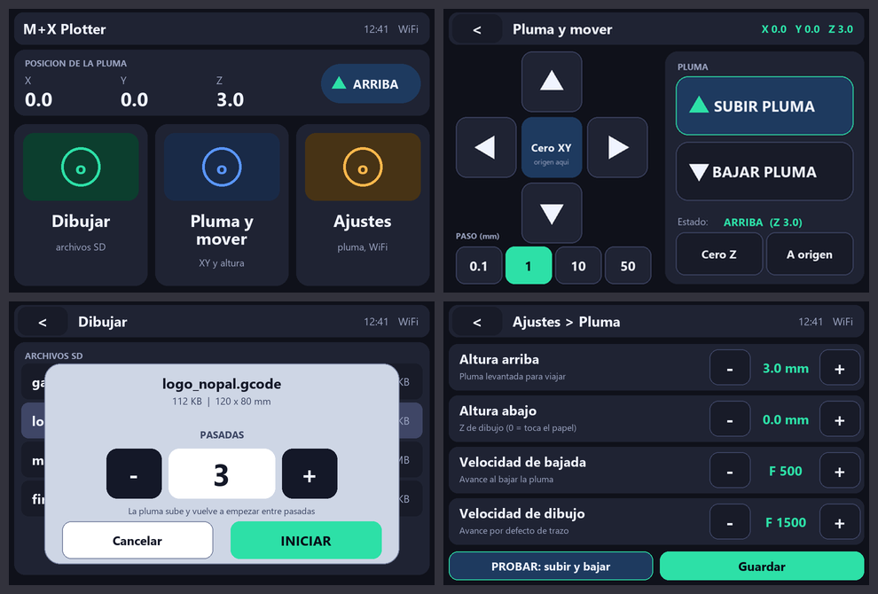
<br><sub><b>Maquetas de diseño</b> de la pantalla de 480×320 (inicio, pluma y mover, dibujar con pasadas y ajustes de pluma). No son capturas de la pantalla real.</sub>
</div>

### Qué cambia

- **Inicio**: tres mosaicos: *Dibujar* (archivos de la SD), *Pluma y mover* y *Ajustes*.
- **Pluma y mover** (pantalla nueva): cruceta X/Y con pasos de 0.1, 1, 10 y 50 mm y un **paso personalizado** (se teclea de 0,01 a 400 mm), **SUBIR** y **BAJAR PLUMA**, *Cero XY*, *Cero Z* y *A origen*. Muestra el estado de la pluma (arriba, abajo o en movimiento).
  - **Home** (icono de casa, esquina de la cruceta): desbloquea si hay alarma, sube la pluma, espera a que la máquina pare y lanza el homing (`$H`).
  - **Velocidad** de los movimientos manuales: botones **−** y **+** (de 100 en 100 hasta 1000 y de 500 en 500 por encima) o tocar el valor para escribirla con el teclado (50 a 10000 mm/min). Se guarda en `$45`.
  - La velocidad (`$45`) y el paso personalizado (`$46`) **se guardan solos** 1,5 s después del último cambio, o al salir de la pantalla, y solo con la máquina parada (los ajustes no se pueden escribir en movimiento).
- **Ajustes → Pluma** (la primera pestaña): `$41`–`$44` con botones − y +; se guardan al instante.
- **Pantalla de archivo**: *Sonda Z* pasa a **Pluma** (sube o baja) y *Aire* pasa a **A origen**, así que ya no hay un botón que baje Z hasta tocar.
- **Pasadas**: el aviso dice «Pasadas: N» y **entre pasadas la pluma sube y vuelve a X0 Y0** antes de empezar de nuevo.
- **WebUI**: tarjeta **Pluma** arriba de la vista Control, con el mismo control y los ajustes. Solo aparece si la placa conoce `$41`; con el firmware PLOTTER se oculta lo del láser y «Ir a origen (Z)» (que bajaba la pluma en rápido).
  - **Home seguro**: el botón *Home: subir pluma y buscar interruptores* de la tarjeta Pluma desbloquea si hay alarma, sube la pluma, espera a que la máquina pare y lanza `$H`. El botón *Origen* de la vista Control hace lo mismo cuando la web detecta un plotter.
  - **Botones rápidos** de distancia (0,1 · 1 · 10 · 50) y de velocidad (500 · 1000 · 1500 · 3000) del movimiento manual; rellenan los campos de siempre, que aceptan cualquier valor.
  - Con el firmware de **servo** (`PLT.SRV` en `[ESP420]`) sube y baja la pluma en coordenadas de máquina (`G53`) y oculta *Cero Z*.

### Cómo se mueve la pluma

La pluma se mueve con **Z en coordenadas de trabajo**: `Z = 0` es la pluma tocando el papel. Subir manda `$J=G90G21Z<$41>` y bajar `$J=G90G21Z<$42>`; solo con la máquina parada.

1. Lleva la pluma hasta que **apenas toque el papel** (con el movimiento manual).
2. Pulsa **Cero Z**: queda `Z = 0` (`G92 Z0`). Pide confirmación en la WebUI.
3. `$41` define cuánto sube para viajar y `$42` a qué altura dibuja (0 = toca el papel).

> [!NOTE]
> Entre pasadas se usan movimientos absolutos (`G90`): los archivos de dibujo deben ir en coordenadas absolutas.

### Pluma con servo RC

El entorno `mks_dlc32_v2_1_plotter_servo` (`-D PEN_SERVO`) sube y baja la pluma con un **servo RC** en vez de un motor paso a paso: el eje **Z es un servo** en el **GPIO 22**. Quita el motor Z, el final de carrera de Z y la sonda (el GPIO 22 pasa a ser la salida del servo). El servo recorre pulsos de 1,0 a 2,0 ms entre Z=0 y `$132`; `$41` y `$42` fijan la altura de arriba y de abajo dentro de ese recorrido.

**Conexión: conector J12 «Probe»** (3 pines, con el mismo orden que un servo):

| Pin de J12 | Señal | Cable del servo |
|---|---|---|
| 1 | GND | marrón o negro |
| 2 | +5 V | rojo |
| 3 | señal (GPIO 22, 3,3 V) | naranja o amarillo |

> [!CAUTION]
> **No conectes el servo al conector del láser (J18):** sus pines son **+12 V**, GND y señal, y el servo se quemaría. Antes de conectar, **mide 5 V entre los pines 1 y 2 de J12** con el servo desconectado.
> Los pinouts de esta sección salen de la hoja `V2.0_001` del esquema de MKS (carpeta `V2.1_003` de su repositorio); tu placa puede diferir. El rail de 5 V sale de un convertidor con polifusible de capacidad desconocida: sirve para un micro servo; si la placa se reinicia al mover, alimenta el servo aparte compartiendo GND.

**Ajustes después de flashear.** Los ajustes viven en la memoria de la placa; los valores por defecto del firmware solo se aplican a los que no están guardados.

| Ajuste | Valor | Para qué |
|---|---|---|
| `$23` | sumar el bit de Z (**4**) al valor actual | el servo recorre de 0 a `$132` (con los interruptores de X e Y en el sentido negativo, `$23=7`) |
| `$1` | `255` | mantiene el servo alimentado para sostener la pluma (con `25` se suelta a los 25 ms) |
| `$132` | `10` | recorrido del servo (los «mm» de Z son posiciones del servo) |
| `$3` | sumar el bit de Z (**4**) si el servo va al revés | invierte el sentido del servo |
| `$41` / `$42` | p. ej. 5 / -0.5 | altura de pluma arriba y abajo, dentro del recorrido |

- Subir y bajar la pluma usan **coordenadas de máquina** (`G53`), así que no dependen de ningún `G92`. Por eso la pantalla no muestra *Cero Z*.
- **Al activarse por primera vez, el servo va a Z=0, que es pluma abajo:** monta la pluma alta o sin papel en la primera prueba.
- Calibración fina de los extremos: `$Z/RcServo/Cal/Min` y `$Z/RcServo/Cal/Max`.

### Finales de carrera y homing

Los conectores **J9 (X−), J10 (Y−) y J11 (Z−)** son también GND, **+5 V** y señal (pines 1, 2 y 3), y cada señal tiene un pull-up a 3,3 V en la placa. Las señales entran por GPIO 36 (X), 35 (Y) y 34 (Z).

> [!WARNING]
> Un interruptor de dos cables va entre el **pin 3 (señal) y el pin 1 (GND)**. **Nunca lo conectes al pin 2**: meterías 5 V en una entrada del ESP32, que solo tolera 3,3 V.

- **`$5`** es la polaridad de los límites. Con interruptores normalmente abiertos, `$5=0`: en reposo el campo `Pn:` del informe de estado (`?`) sale vacío y al pulsar un interruptor aparece su letra. Compruébalo a mano antes del primer homing.
- **`$23`** fija el sentido del homing: con el bit de un eje puesto, ese eje va hacia el sentido **negativo**; con el bit a cero, hacia el positivo (X vale 1, Y vale 2 y Z vale 4). Si los interruptores están en el origen, X e Y llevan el bit puesto.
- La primera vez, baja la velocidad de búsqueda `$25` (por ejemplo 800 mm/min), deja el carro libre y ten la mano en la alimentación por si algún interruptor no responde.
- Ejemplo probado por el autor: interruptores a la izquierda (X) y al frente (Y), `+X` hacia la derecha y `+Y` hacia el fondo, `$23=7`, `$5=0`, `$24=300` y `$25=1500`.

### Instalar (por cable)

| Entorno | Tabla de particiones | Aplicación | WebUI (SPIFFS) |
|---|---|---|---|
| `mks_dlc32_v2_1_plotter` | de fábrica de 4 MB (`huge_app`) | `0x10000` (3 MB) | `0x310000` (960 KB) |
| `mks_dlc32_v2_1_plotter_servo` | de fábrica de 4 MB (`huge_app`) | `0x10000` (3 MB) | `0x310000` (960 KB) |
| `mks_dlc32_v2_1_8mb_plotter` | de 8 MB de este repositorio | `0x10000` (4 MB) | `0x410000` |

```bash
cd Firmware
pio run -e mks_dlc32_v2_1_plotter                                    # compilar
pio run -e mks_dlc32_v2_1_plotter -t upload   --upload-port <puerto> # aplicación
pio run -e mks_dlc32_v2_1_plotter -t uploadfs --upload-port <puerto> # WebUI
```

**La WebUI va aparte de la aplicación** (partición SPIFFS): si solo escribes la aplicación, la placa sigue sirviendo la web que tuviera antes. Cámbiala con `uploadfs` o desde *Acerca de → Actualizar WebUI*.

> [!WARNING]
> **No actualices el firmware con la opción «Actualizar firmware» de la página.** Con esta tabla de particiones hay **un solo slot de aplicación**, así que la subida escribe sobre la aplicación que está en uso: si se interrumpe, la placa se queda sin firmware. Instala siempre por cable. La WebUI sí se puede actualizar sin cable, porque va en otra partición.

### Entrar en modo de descarga en la DLC32 V2.1

El circuito de reset de la V2.1 **cruza DTR y RTS** (no es el montaje clásico), por eso la secuencia por defecto de algunas herramientas no la hace entrar. Con la secuencia cruzada sí: deja RESET abajo (DTR inactivo, RTS activo) unos 0,3 s y después suelta RESET con IO0 abajo (DTR activo, RTS inactivo). El modo de descarga **no imprime nada**: para saber si entró hay que mandarle un SYNC. Alternativa: llevar IO0 (`SDA` del conector «I²C interface») a GND y dar un toque a RESET. Si el flasheo por USB falla o se corrompe, prueba un puerto USB directo y escribe en trozos pequeños verificando cada uno.

### Limitaciones conocidas

- Las pantallas se diseñaron sin simulador ni capturas de la placa real: las imágenes de esta sección son maquetas.
- En la WebUI, la distancia y la velocidad del movimiento manual se pierden al recargar la página (la pantalla de la máquina sí las guarda en `$45` y `$46`).
- El guardado de `$45` y `$46` está implementado y flasheado, pero falta la prueba de apagar y volver a encender la placa para confirmar que conserva los valores.
- El Home de la WebUI y sus botones rápidos están compilados y servidos por la placa, pero no han pasado todavía una prueba completa en la máquina.
- La WebUI de una placa con **señal WiFi baja** puede tardar decenas de segundos en cargar (ver *Problemas frecuentes*).

---

## 🚀 Compilar y flashear

Necesitas [PlatformIO](https://platformio.org/). Desde `Firmware/`:

```bash
pio run -e mks_dlc32_8mb                                          # compilar
pio run -e mks_dlc32_8mb -t upload   --upload-port <puerto>       # firmware      (<puerto>: /dev/ttyUSB0, COM5…)
pio run -e mks_dlc32_8mb -t uploadfs --upload-port <puerto>       # WebUI (SPIFFS)
```

Resultado esperado: **Flash ≈ 47 %, RAM ≈ 25 %**.

| Entorno | Hardware |
|---|---|
| `mks_dlc32_8mb` | **MKS LTS V1.1, flash de 8 MB** (probado) |
| `mks_dlc32_v2_1` | MKS DLC32 **V2.x, flash de 4 MB** (**experimental, sin probar**) |
| `mks_dlc32_v2_1_8mb` | MKS DLC32 **V2.x, flash de 8 MB** (**experimental, sin probar**) |
| `mks_dlc32_v2_1_CoreXY` | Entorno original de MKS para CoreXY, sin probar |
| `mks_dlc32_v2_1_plotter` | **Plotter de pluma** en MKS DLC32 **V2.1 con la tabla de fábrica de 4 MB** (**probado**) |
| `mks_dlc32_v2_1_8mb_plotter` | Plotter de pluma en MKS DLC32 V2.1 con la tabla de 8 MB (compila; misma base que el anterior) |
| `mks_dlc32_v2_1_plotter_servo` | **Plotter con la pluma en un servo RC** (GPIO22, conector J12 *Probe*), V2.1 con la tabla de fábrica de 4 MB (**probado**; ver [Pluma con servo RC](#pluma-con-servo-rc)) |

> [!WARNING]
> **Flashea solo con la máquina parada.** Abrir el puerto serie reinicia el ESP32 y detiene el trabajo. Y que **ningún otro programa tenga el puerto abierto** (monitores serie, gestores de impresoras…): un flasheo a medias deja la placa sin firmware hasta repetirlo.

Después de flashear, la placa se conecta a tu Wifi desde *Herramientas → Wifi* y la WebUI queda en `http://<ip>/`.

## 📡 Actualizar la WebUI sin cable

*Acerca de → **Actualizar WebUI***: elige `index.html.gz` (o un `index.html`, que el navegador comprime) y espera a que la página se recargue. Se niega si hay un trabajo en marcha.

```bash
python3 webui/build.py            # genera Firmware/Grbl_Esp32/data/index.html.gz
python3 webui/build.py --check    # comprueba que el .gz esté al día con las fuentes
```

Si la interfaz dejara de abrir, entra en `http://<ip>/?index=yes`: la placa muestra una página de emergencia para volver a subir el archivo. Detalles en [`webui/README.md`](webui/README.md).

## 🖼️ Imagen de inicio

La imagen que se ve al encender (**PNG de 480×320**) va dentro del firmware (hoy es el logo de M+X). Se convierte con una herramienta sin dependencias:

```bash
python3 tools/png2lvgl.py logo.png      # reemplaza Firmware/Grbl_Esp32/src/lv_pic/mks_logo.c
```

Luego compila y flashea el firmware.

## 🧰 Simulador del LCD y capturas

[`tools/lcd-sim`](tools/lcd-sim) compila **el mismo código de las pantallas** en el PC (LVGL 6.1.1 + un «firmware falso») y vuelca PNG de cada pantalla. Sirve para **ver un cambio sin flashear**.

```bash
cd tools/lcd-sim && make -j4 shots      # regenera docs/pantallas/{es,en,zh}   (solo gcc, make y python3)
```

Las capturas de la WebUI las hace [`tools/webui-shots`](tools/webui-shots) con una placa falsa y Firefox sin pantalla.

---

## 🗂️ Estructura del repositorio

```text
.
├── Firmware/                    PlatformIO (Grbl_ESP32 + MKS)
│   ├── platformio.ini · ini/    entornos de compilación
│   └── Grbl_Esp32/
│       ├── src/                 firmware (Protocol, Stepper, Spindles, WebUI…)
│       │   ├── mks/             pantallas del LCD (LVGL), idiomas, tareas (MKS_draw_pen.cpp: pluma del plotter)
│       │   ├── lv_pic/          iconos, fuentes e imagen de inicio
│       │   └── Machines/        mapa de pines y valores de fábrica (MKS DLC32)
│       ├── data/index.html.gz   WebUI compilada (lo que sirve la placa)
│       └── ld/                  tabla de particiones de 8 MB
├── webui/                       fuentes de la WebUI (HTML, CSS, JS, idiomas, pruebas)
├── tools/
│   ├── lcd-sim/                 simulador del LCD
│   ├── webui-shots/             placa falsa y capturas de la WebUI
│   └── png2lvgl.py              PNG → imagen de inicio
└── docs/                        capturas (pantallas del LCD y WebUI)
```

## 🩺 Problemas frecuentes

<details>
<summary><b>Un archivo con <code>ñ</code> o acentos en el nombre no arrancaba</b></summary>

Estaba resuelto en esta versión: los bytes UTF-8 de los nombres ya no se confunden con comandos de tiempo real de Grbl. Si ves `error:66` con un archivo así, comprueba que tienes el firmware actualizado.
</details>

<details>
<summary><b>Pulsé «Tallado» con un trabajo en marcha y se paró</b></summary>

En el firmware original, abrir la lista de la SD desmontaba la tarjeta y mataba el trabajo. Aquí, con un trabajo en curso, esos botones llevan a la pantalla de trabajo y no tocan la SD. La LCD también salta sola a esa pantalla si lanzas el archivo desde la WebUI.
</details>

<details>
<summary><b>El flasheo falla con <code>Invalid head of packet</code> o la placa no responde después</b></summary>

Otro programa tiene abierto el puerto serie. Ciérralo (o detén el servicio que lo use), comprueba que el puerto está libre y **repite el flasheo completo**: la placa no arrancará hasta que termine bien.
</details>

<details>
<summary><b>La hora de la pantalla principal sale <code>--:--</code></b></summary>

La placa no tiene reloj propio: la hora llega por NTP en cuanto el Wifi conecta (zona fija `CST6`). Sin salida a internet se queda en `--:--`.
</details>

<details>
<summary><b>El láser enciende al elegir un % pero «no hace nada» a mano</b></summary>

En modo láser (`$32=1`) un `M3 S…` suelto no enciende mientras el modo de movimiento sea G0. El botón de la pantalla ya manda `G1 F1000 M3 S…`; si lo haces desde la consola, usa lo mismo.
</details>

<details>
<summary><b>La WebUI tarda mucho en cargar y la placa responde con retraso</b></summary>

Mira la señal WiFi en `[ESP420]` (línea `Signal`). Con una señal baja (se midió un 26 %) la página de ~65 KB tardó 15–40 s en una placa, frente a 0,6 s en otra con el 100 %. El servidor web comparte el lazo principal del firmware: mientras sirve la página con un enlace malo, el resto (también el puerto serie) se retrasa. Acerca la placa al router o mejora su antena.
</details>

## 📜 Qué cambió respecto al firmware de MKS

- **Rampa del PWM fuera de la interrupción** (causaba tartamudeo, ruido y reinicios en grabados con segmentos cortos).
- **Laser real**: `SpindleType::LASER`, `$32=1` por defecto y M4 funcional; potencia calculada sobre `$30`.
- **LCD** rediseñada, con fuentes Latin-1 y chino; listas y diales nuevos; marco con aviso; reloj por NTP.
- **WebUI propia** en lugar de la de ESP3D: control, SD con vista previa, parámetros con respaldo, tres idiomas y actualización por web.
- **SD**: nombres UTF-8, páginas circulares, y la LCD ya no desmonta la tarjeta durante un trabajo.
- **Sonidos** de fin de trabajo, error y alarma (`$39`).
- **Valores de fábrica** calibrados (300×300 mm, homing, modo láser) y nombre de placa correcto (*MKS LTS V1.1*).
- Diagnóstico `[diag]` opcional tras `#define ENABLE_JOB_DIAG` (apagado).
- **Variante PLOTTER** (`-D PLOTTER_MODE`): pantalla y WebUI de control de pluma, ajustes `$41`–`$46` y pasadas con la pluma levantada entre una y otra. Pantalla con **Home**, velocidad manual y **paso personalizado**; opción de **servo RC** (`-D PEN_SERVO`) en el conector J12.

## 🙏 Créditos y licencia

Este proyecto se apoya en el trabajo de otros:

- [**MKS DLC32** (Makerbase)](https://github.com/makerbase-mks/MKS-DLC32-FIRMWARE): el firmware original en el que se basa M+X.
- [**Grbl_ESP32**](https://github.com/bdring/Grbl_Esp32): núcleo de control de movimiento para ESP32.
- [**Grbl**](https://github.com/gnea/grbl): intérprete de G-code y planificador originales.
- [**LVGL**](https://lvgl.io): biblioteca gráfica de la pantalla táctil.

Licencia **GNU General Public License v3** (ver [`LICENSE`](LICENSE)). Se distribuye **sin ninguna garantía**: un láser o una CNC mal configurados pueden dañar la máquina o causar lesiones. Úsalo bajo tu responsabilidad.
